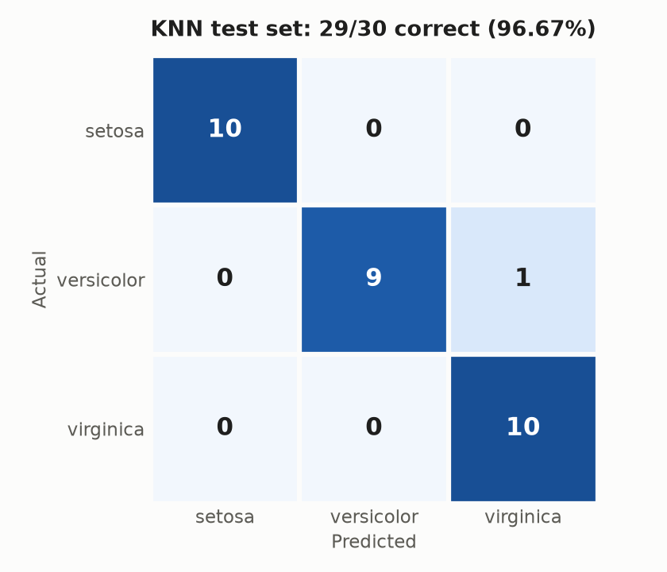
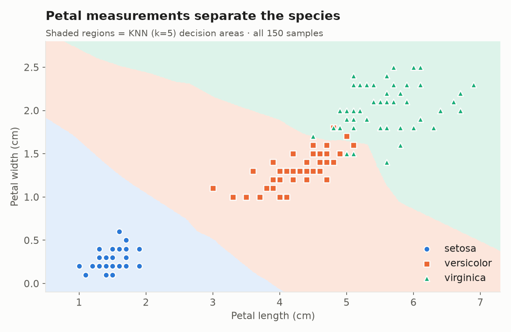

# 🌸 Iris Flower Classification


This project classifies Iris flowers into three species (**setosa**, **versicolor**, **virginica**) from their petal measurements. It compares **Logistic Regression**, a **Decision Tree** and **K-Nearest Neighbors**, then saves the best model and uses it to make predictions.

It covers the whole workflow: EDA → feature selection → training → hyperparameter tuning (`GridSearchCV`) → cross-validated comparison → saving the model → prediction.

---

## 📊 Results

The three models were compared with stratified 5-fold cross-validation on the training set. Each one was then scored on the same held-out test set of 30 samples.

| Model | CV Mean Accuracy | CV Std | Test Accuracy |
|---|---:|---:|---:|
| **KNN** (`n_neighbors=5`, scaled) 🏆 | **96.67%** | **0.0167** | **96.67%** |
| Logistic Regression (scaled) | 95.83% | 0.0264 | 93.33% |
| Decision Tree (`max_depth=4`) | 92.50% | 0.0312 | 93.33% |

**KNN** had the highest CV accuracy and the lowest variance across folds, and it got 29 of the 30 test samples right. It was saved as a `StandardScaler → KNeighborsClassifier` pipeline, so new inputs are scaled automatically.

<p align="center">
  
</p>

> These results apply to this dataset, these two features and this train/test split (`random_state=42`). They don't mean KNN is better in general.

---

## 📂 Project Structure

```text
ML_01_Iris_Flower_Classification/
├── iris/
│   ├── iris.data             # Dataset used by the notebooks (UCI)
│   ├── bezdekIris.data       # Corrected version of the dataset (UCI)
│   ├── iris.names            # Dataset description
│   └── Index
├── 01_logisticRegression.ipynb   # EDA, Logistic Regression, CV, overfitting demo
├── 02_decisionTree.ipynb         # Decision Tree + GridSearchCV over max_depth
├── 03_kNN.ipynb                  # KNN with scaling + GridSearchCV over n_neighbors
├── 04_modelEval.ipynb            # Model comparison, saving the model, prediction
├── models/
│   └── best_knn_model.pkl        # Saved StandardScaler + KNN pipeline
├── images/                       # Figures used in this README
├── requirements.txt
└── README.md
```

`04_modelEval.ipynb` saves the trained model to `models/best_knn_model.pkl`.

---

## 🗂️ Dataset

The [UCI Iris dataset](https://archive.ics.uci.edu/dataset/53/iris) has **150 samples**, 50 per species, with 4 numeric features and no missing values.

| Feature | Used? |
|---|:---:|
| `sepal_length` | ❌ |
| `sepal_width` | ❌ |
| `petal_length` | ✅ |
| `petal_width` | ✅ |
| `species` (target) | 🎯 |

**Why only petal features?** In the EDA pairplot, petal length and petal width separate the three species much more clearly than the sepal measurements. All models use the same two features so the comparison is fair.

<p align="center">
  
</p>

---

## ⚙️ Methodology

1. **EDA**: checked the shape, data types, missing values and class balance, looked at summary statistics and per-species means, and made a `seaborn` pairplot.
2. **Split**: 80/20 train/test split, stratified, `random_state=42` (120 train / 30 test).
3. **Models**
   - **Logistic Regression**: `max_iter=200`, with `StandardScaler` in a pipeline.
   - **Decision Tree**: `GridSearchCV` over `max_depth ∈ {1, 2, 3, 4, 5, None}` picked **4**. Notebook 01 also compares depths 1, 2 and unlimited to show underfitting and overfitting.
   - **KNN**: `GridSearchCV` over `n_neighbors ∈ {3, 5, 7, 9, 11, 13, 15}` picked **5**, with `StandardScaler` in a pipeline.
4. **Evaluation**: accuracy, confusion matrix, classification report (precision, recall, F1) and cross-validation.
5. **Comparison**: all three models are scored on the same `StratifiedKFold(n_splits=5, shuffle=True, random_state=42)` splits.
6. **Saving**: the best pipeline is saved with `joblib`.

---

## 🚀 Getting Started

### 1. Clone the repository

```bash
git clone https://github.com/PrajotShrivastava/ML_01_Iris_Flower_Classification.git
cd ML_01_Iris_Flower_Classification
```

### 2. Install dependencies

```bash
python -m venv venv
source venv/bin/activate        # Windows: venv\Scripts\activate
pip install -r requirements.txt
```

### 3. Run the notebooks

```bash
jupyter notebook
```

Run the notebooks in order (`01` → `04`). `04_modelEval.ipynb` trains the final model and saves it to `models/best_knn_model.pkl`.

---

## 🔮 Making a Prediction

```python
import joblib
import pandas as pd

model = joblib.load("models/best_knn_model.pkl")

new_flower = pd.DataFrame({
    "petal_length": [1.5],
    "petal_width":  [0.2],
})

print("Predicted Species:", model.predict(new_flower)[0])
# Predicted Species: Iris-setosa
```

---

## 🛠️ Tech Stack

**Python** · **pandas** · **NumPy** · **Matplotlib** · **Seaborn** · **scikit-learn** · **Joblib** · **Jupyter**

---

## 📚 What I Learned

- Choosing features from what EDA shows
- Why distance-based models (KNN) and linear models need feature scaling
- Spotting overfitting and underfitting by comparing train and test accuracy
- Using cross-validation and `GridSearchCV` to choose hyperparameters
- Wrapping preprocessing and the model in a `Pipeline` so new data is processed the same way
- Saving a trained model and loading it to make predictions

## 🧭 Future Improvements

- Try all four features and compare with the petal-only models
- Add more classifiers (SVM, Random Forest, Gradient Boosting)
- Plot the decision boundaries for each model
- Serve the model through a small Streamlit or Flask app

---

## 👤 Author

**Prajot Shrivastava**

⭐ If you found this useful, consider starring the repo!
